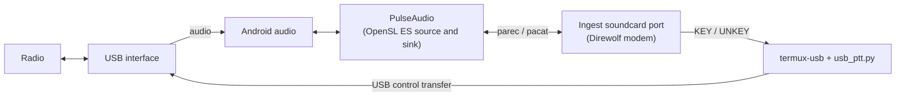

# Radio on the phone

This page sets up the ingest's [soundcard port](../radios/soundcard.md) on a Pocket station, with a USB radio
interface on the phone's USB-C port: a Digirig, an AIOC (All-In-One-Cable) or a CM108 sound dongle. It is for
the sysop who runs the phone. At the end the phone decodes what the radio hears and, once you allow it,
transmits through it, with no TNC.

Termux has no ALSA and no access to `/dev/tty*` or `/dev/hidraw*` without root. So the port takes its audio
from PulseAudio, which reaches Android's audio through OpenSL ES, and keys the radio through Termux:API's
`termux-usb`, which hands a small helper the interface's USB device.

!!! warning "Not yet verified on hardware"
    Every piece is tested against fakes and in the Termux container, but no phone has yet run this with a radio
    attached. Check each point in [Check on your hardware](#check-on-your-hardware) on a dummy load before you
    transmit on the air, and turn on the radio's own transmit time-out: a phone that crashes or runs flat gets
    no chance to unkey.

## Before you start

- **Pocket** installed and running ([Install Pocket on an Android phone](../install/pocket.md)).
- **Termux:API** from the same source as Termux, opened once ([Pocket extras](extras.md)).
- **A USB-C OTG adapter**, unless the interface has a USB-C plug, and a radio cable for your radio.
- **A USB radio interface** from the table below.
- **To transmit**: your licence, and every callsign the phone transmits under control-verified on the instance
  ([The transmit gate](../radios/soundcard.md#the-transmit-gate)). Read
  [Automatic stations on the air](../compliance/on-air-stations.md) first.

| Interface | On the USB bus | Keys the radio by | `SOUNDCARD_PTT` |
|---|---|---|---|
| Digirig Mobile | a hub with a C-Media audio codec and a Silicon Labs CP2102 serial chip (`10c4:ea60`): two devices | the CP2102's RTS line | `termux-usb:<CP2102 path>:cp210x-rts` |
| AIOC | one device (`1209:7388`): USB audio, a CDC-ACM serial port and, from firmware 1.2.0, a CM108-style HID | DTR set with RTS clear, or the HID's GPIO3 | `termux-usb` (DTR), or `termux-usb:auto:cm108:3` |
| CM108 or CM119 dongle with PTT on a GPIO pin | one device (`0d8c:*`): audio and HID | the GPIO pin, usually GPIO3 | `termux-usb:auto:cm108:3` |
| Audio dongle with an FTDI or CH340 serial cable for PTT | two devices | RTS or DTR | `termux-usb:<serial path>:ftdi-rts` or `ch340-rts` |

The AIOC's PTT lines come from its [README](https://github.com/skuep/AIOC): PTT on `DTR=1` and `RTS=0`, and the
CM108-compatible PTT since firmware 1.2.0.

## How it fits together



The helper, `deploy/pocket/extras/usb_ptt.py`, keys the line with USB control transfers on the descriptor
`termux-usb` passes: a CDC-ACM, CP210x, FTDI or CH340 serial line, or a CM108 GPIO pin.

## Steps

### 1. Install PulseAudio

```bash
pkg install pulseaudio termux-api python
```

Pocket's installer has already installed `termux-api` and `python`; the command adds PulseAudio.

### 2. Give Termux the microphone

PulseAudio records through Android, which asks for the microphone permission. Termux and Termux:API share one
Android user ID, so the permission Termux:API holds counts for PulseAudio in Termux too. Record one second
with Termux:API and choose **Allow** when Android asks:

```bash
termux-microphone-record -l 1 -f "$TMPDIR/mic-test.m4a"
```

Or set it in Android: Settings → Apps → Termux:API → Permissions → Microphone → **Allow**. Without it,
PulseAudio logs `Failed to initialize OpenSL ES; did you grant Termux the RECORD_AUDIO permission`.

### 3. Start PulseAudio

```bash
pulseaudio --start --load="module-sles-source" --exit-idle-time=-1
```

Termux's PulseAudio package loads the playback sink, `module-sles-sink`, from its own `default.pa`; the
command adds the capture source and keeps the server running when idle. Pocket starts PulseAudio this way
before each start of the ingest when a soundcard port uses it, so after this first time you need not.

`pactl list short sources` and `pactl list short sinks` list what the server has. If playback stays silent on
Android 8 or later, the package suggests the AAudio sink instead:
`sed -i 's/module-sles-sink/module-aaudio-sink/g' $PREFIX/etc/pulse/default.pa`, then
`pulseaudio --kill` and start it again.

### 4. Attach the interface and allow it

Plug the interface in, through the OTG adapter, and list what Android sees:

```bash
termux-usb -l
```

Each device shows as a path such as `/dev/bus/usb/001/002`. Allow each one once; Android asks:

```bash
termux-usb -r /dev/bus/usb/001/002
```

The AIOC and a CM108 dongle are one device, and `auto` finds it. A Digirig shows two devices: its audio codec
and its CP2102. To see which path is which, run the helper on each and read the first line it prints. It drives
the line to unkeyed and waits; press **Ctrl-D** to end it without keying:

```bash
termux-usb -r -e "python3 $HOME/aprscaching/deploy/pocket/extras/usb_ptt.py --method auto" /dev/bus/usb/001/003
```

`READY 10c4:ea60 CP210x RTS (interface 0)` is the CP2102. A device the helper does not know answers
`ERR device <vid>:<pid> is not a known radio interface`.

### 5. Turn the port on

In `~/.aprscaching/.env`. Receive needs only the first two lines:

```
SOUNDCARD_DEVICE=default
SOUNDCARD_AUDIO=pulse
```

With `SOUNDCARD_AUDIO=pulse`, `SOUNDCARD_DEVICE` names a PulseAudio source and `SOUNDCARD_PLAYBACK` a sink;
`default` is the server's own. Android routes an attached USB audio interface to the OpenSL ES source and
sink behind them; check that it does on your phone ([Check on your hardware](#check-on-your-hardware)).

To transmit, add the PTT for your interface and your call:

=== "Digirig"

    ```
    SOUNDCARD_TX=1
    SOUNDCARD_PTT=termux-usb:/dev/bus/usb/001/003:cp210x-rts
    BOX_CALL=OE8APR-10
    ```

=== "AIOC"

    ```
    SOUNDCARD_TX=1
    SOUNDCARD_PTT=termux-usb:auto:cdc-dtr
    BOX_CALL=OE8APR-10
    ```

=== "CM108 dongle"

    ```
    SOUNDCARD_TX=1
    SOUNDCARD_PTT=termux-usb:auto:cm108:3
    BOX_CALL=OE8APR-10
    ```

`SOUNDCARD_PTT=termux-usb[:<device>[:<method>[:<gpio>]]]`: the device is `auto` (the only one attached) or a
path from `termux-usb -l`; the method is `auto` (chosen by the device's VID:PID) or one of `cdc-dtr`,
`cdc-rts`, `cp210x-rts`, `cp210x-dtr`, `ftdi-rts`, `ftdi-dtr`, `ch340-rts`, `ch340-dtr` and `cm108`, which
takes the GPIO (default 3). A Digirig's path changes when it is plugged in again; set the new one.

Restart the ingest:

```bash
bash ~/aprscaching/deploy/pocket/restart.sh ingest
```

The log (`~/.aprscaching/logs/ingest.log`) shows `[soundcard:1] capturing default at 48000 Hz` and, with
transmit on, `[soundcard:1] transmit on, PTT termux-usb /dev/bus/usb/001/003: 10c4:ea60 CP210x RTS (interface 0)`.

### 6. Set the levels

- **Receive**: the radio's volume to about a third, squelch closed, then the capture level:
  `pactl set-source-volume @DEFAULT_SOURCE@ 100%`. Lower it if the tones clip.
- **Transmit**: about 3 kHz deviation for 1200-baud APRS. Set the playback level with
  `pactl set-sink-volume @DEFAULT_SINK@ 60%` and Android's media volume, and fine-tune with
  `SOUNDCARD_TX_LEVEL` (0.01 to 1, default 0.5). Decode your own frames on a second receiver.

### 7. Check it

The ingest's own checks find PulseAudio's tools, open the source and the sink, load the modem and check the PTT
helper and the attached device. They never key the radio. They read the station's settings from the `.env`:

```bash
(set -a; . ~/.aprscaching/.env; set +a; cd ~/aprscaching/apps/ingest && node --import tsx src/check.ts --soundcard)
```

To prove the keying line, run the PTT test with the gateway up and the ingest stopped: the running ingest's
helper holds the interface. The test keys for half a second with no audio, only when the gateway confirms your
calls and the channel is clear. Run it on a dummy load:

```bash
bash ~/aprscaching/deploy/pocket/stop.sh
bash ~/aprscaching/deploy/pocket/start.sh --no-attach --gateway-only
(set -a; . ~/.aprscaching/.env; set +a; cd ~/aprscaching/apps/ingest && node --import tsx src/check.ts --ptt-test)
bash ~/aprscaching/deploy/pocket/stop.sh && bash ~/aprscaching/deploy/pocket/start.sh --no-attach
```

It prints `PTT test on port 1: termux-usb … keyed for 500 ms and released`, or why it refused.

## How the PTT stays safe

The helper drives the line to unkeyed when it starts, on every error, when its input ends (the ingest stopped
or died), on SIGTERM, and on its way out. It holds a watchdog of its own: a line keyed longer than
`SOUNDCARD_PTT_MAX_MS` plus two seconds without a fresh key is unkeyed. In front of it, the port's PTT watchdog
ends a transmission at `SOUNDCARD_PTT_MAX_MS` and latches a fault until the ingest restarts.

When an interface is unplugged while idle, the driver starts the helper again in the background until the
interface is back; with `auto` it finds the new path. A frame that comes up meanwhile is dropped and logged. A
helper that dies while the line may be keyed faults the port. Termux:API keeps its own copy of the USB
descriptor open, so the helper releases the interfaces it claimed as it exits. If a helper is killed outright,
a claim can outlive it and the next one answers `Device or resource busy`: force-stop Termux:API in Android's
app settings, then restart the ingest.

## Keep it running

Set Settings → Apps → **Termux** and **Termux:API** → Battery → **Unrestricted**, so Android does not stop
PulseAudio, the helper or Termux:API's USB service with the screen off. The rest is in
[Run Pocket in the field: keep it running](field-station.md#keep-it-running).

## Troubleshooting

| What you see | Why, and what to do |
|---|---|
| `parec not found: install PulseAudio` | `pkg install pulseaudio`. |
| `Connection failure: Connection refused — start PulseAudio` | The server is not running: step 3. |
| Capture runs, nothing decodes | Android records from the phone's microphone instead of the interface, or the level is wrong. Unplug and replug the interface, restart PulseAudio, and check the receive level. |
| `termux-usb not found` or `termux-usb -l did not answer` | Install Termux:API from the same source as Termux, open it once, and `pkg install termux-api`. |
| `several USB devices are attached` | Name the interface's path in `SOUNDCARD_PTT` (step 4). |
| `Permission denied.` | Allow the device: `termux-usb -r <path>`. |
| `Device or resource busy` | An earlier helper's claim survives: force-stop Termux:API, then restart the ingest. |
| `the USB PTT helper did not answer KEY` | The interface stopped answering: check the cable and the OTG adapter. The port faults until the ingest restarts. |

## Check on your hardware

- **Unverified:** that Android routes the USB interface's audio to PulseAudio's OpenSL ES source and sink on
  your phone, and not the phone's own microphone and speaker; and which of `module-sles-sink` or
  `module-aaudio-sink` plays on it.
- **Unverified:** the receive and transmit levels through Android's volume steps.
- **Unverified:** the latency through Android's audio path. PulseAudio's OpenSL ES modules buffer 125 ms each
  way; the port drops what it decodes within 600 ms after it unkeys, and a longer path would let its own signal
  through. PulseAudio's playback buffer also starts the audio after the key, which lengthens the TXDELAY:
  check the start of your frames on a second receiver and set `SOUNDCARD_TXDELAY_MS`.
- **Unverified:** keying a CM108 GPIO while Android holds the interface's audio: the helper takes the HID
  interface from Android's kernel driver and leaves the audio interfaces alone.
- **Unverified:** the AIOC's CDC-ACM PTT with Android's kernel `cdc_acm` driver bound to it, and the CP2102's
  RTS on a Digirig.
- **Unverified:** that the helper unkeys when Android stops Termux in the background.

## Next

- [Soundcard port](../radios/soundcard.md): the modem, the timing and the transmit gate in full.
- [Run Pocket in the field](field-station.md): keep the station running, visitors and the other radios.
