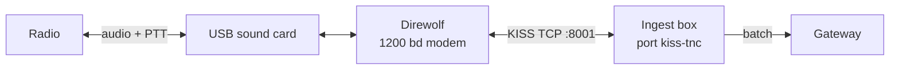

# Direwolf as your TNC

This page pairs [Direwolf](https://github.com/wb2osz/direwolf), the software TNC, with an ingest box. It is for
the sysop who puts a radio on the box through a sound card. At the end Direwolf decodes what the radio hears,
the box reads it over KISS TCP, and its direct hearings count as your receiving site's.

Direwolf is the reference TNC: CI runs the box's KISS and AGWPE clients against two real Direwolf modems joined
by an audio cable every week ([Interop against real packet software](../../contribute/testing.md#interop-against-real-packet-software)).
The configuration below is the one that test uses, with a real radio in place of the cable.



## Before you start

- **An ingest box** on Linux, next to the radio ([Set up an ingest box](ingest-box.md)).
- **Direwolf 1.7 or later.** `direwolf --version` shows it; Ubuntu 24.04's `direwolf` package is the version CI
  runs. One KISS port per channel and IL2P need 1.7.
- **A sound interface and a way to key the radio**: a CM108 or CM119 USB card with PTT on a GPIO pin, a serial
  port's RTS line, or a radio that keys on audio (VOX).
- **One program per sound card.** Direwolf holds the card, so do not also give it to the box's
  [soundcard port](soundcard.md) (`SOUNDCARD_DEVICE`).
- **To transmit**: read [Automatic stations on the air](../compliance/on-air-stations.md) first.

## Steps

### 1. Write `direwolf.conf`

One radio on one USB sound card, 1200 bd APRS:

```ini
# The sound card: `arecord -l` lists it, "card 1 ... device 0" is plughw:1,0
ADEVICE plughw:1,0
ARATE 48000
ACHANNELS 1

CHANNEL 0
# The box's station call: Direwolf uses it for its own ID and connected mode
MYCALL OE8APR-10
MODEM 1200
# Key the radio: pick one PTT line (step 2)
PTT CM108
# FX25TX and IL2PTX stay unset: plain AX.25 (step 3)

# The box reads every channel here; the AGW port serves AGWPE clients
KISSPORT 8001
AGWPORT 8000
```

Leave `TXDELAY`, `PERSIST` and `SLOTTIME` out: the box sends its own after each connect
([step 5](#5-decide-who-sets-the-timing)). Leave Direwolf's own `DIGIPEAT`, `IGSERVER` and `IGTXVIA` out too,
when the box runs the digipeater or the IGate: two digipeaters on one radio repeat each frame twice, and what
Direwolf sends on its own never passes the box's [transmit gate](rf-ingest.md#transmit-gate).

### 2. Choose the PTT line

Receiving needs no PTT. To transmit, give `CHANNEL 0` one of these:

| Interface | `direwolf.conf` | Note |
|---|---|---|
| CM108 / CM119 USB card | `PTT CM108` | GPIO3, the pin almost every interface uses. Direwolf finds the card's `/dev/hidraw*` from `ADEVICE`; name it when it does not: `PTT CM108 3 /dev/hidraw1`. |
| Serial port | `PTT /dev/ttyUSB0 RTS` | `DTR` for the other line; a `-` in front (`-RTS`) keys on low. |
| Raspberry Pi GPIO | `PTT GPIOD 0 25` | gpiochip 0, line 25 (the BCM number, not the header pin). |
| VOX | no `PTT` line | Direwolf notes `PTT not configured for channel 0` at start; ignore it. |

A `/dev/hidraw*` device belongs to root. Direwolf's package installs a udev rule
(`99-direwolf-cmedia.rules`) that gives the `audio` group access; add Direwolf's user to that group. The
[CM108 access](soundcard.md#choose-how-the-radio-is-keyed) note shows the same rule by hand.

!!! warning "VOX holds the transmitter on"
    A radio's built-in VOX keeps transmitting about half a second after the audio ends, and other stations
    start sending into it (Direwolf User Guide, 9.2.11). Use a wired PTT line. With an interface that keys on
    audio, raise the TX delay until its keying is inside it ([TNC timing](rf-ingest.md#tnc-timing)).

Set the radio's own transmit time-out timer as well. It is the only release when Direwolf or the box dies with
the transmitter keyed.

### 3. Keep FX.25 off and IL2P off

Direwolf can add forward error correction to what it transmits. On a shared 1200 bd APRS channel, send plain
AX.25:

| Setting | Recommendation | Why |
|---|---|---|
| `FX25TX` | `0` (the default), or `1` on a link you know is poor | An FX.25 frame carries the normal AX.25 frame inside, so a receiver without FX.25 still decodes it. The parity bytes make every frame longer on a busy channel. |
| `IL2PTX` | unset | IL2P is more efficient than FX.25 but is not interoperable with AX.25 receivers: most APRS stations would not decode you. |

Receiving needs no setting: Direwolf always decodes FX.25, and receives IL2P in both polarities. Over KISS the
box gets the plain AX.25 frame in every case. `FX25TX` applies to everything the channel sends, digipeated
frames included.

Sources: the Direwolf User Guide, sections 9.2.9 and 9.2.10, and
[AX.25 + FEC = FX.25](https://github.com/wb2osz/direwolf/blob/master/doc/AX25_plus_FEC_equals_FX25.pdf), both
in [Direwolf's `doc` folder](https://github.com/wb2osz/direwolf/tree/master/doc).

### 4. Start Direwolf and set the receive level

```bash
direwolf -t 0 -c ~/direwolf.conf
```

`-t 0` turns off the colour codes, for a log file. Each decoded frame shows a line such as
`OE8XYZ-9 audio level = 52(13/8)`. Set the card's capture level (`alsamixer -c 1`, **F4** for capture) so most
stations sit around 50, as the User Guide suggests (section 7.2.2): that leaves headroom and keeps the converter out of
clipping. The line `Ready to accept KISS TCP client application 0 on port 8001` shows the KISS port is open.

To start Direwolf with the machine, run it as a systemd service or from `cron`; the User Guide's section 5.9
shows both.

### 5. Decide who sets the timing

After each connect, the box sends Direwolf three KISS frames: TX delay, persist and slot time. Direwolf applies
them to the channel in place of `TXDELAY`, `PERSIST` and `SLOTTIME` in `direwolf.conf`, until it restarts.
`TXTAIL` and `FULLDUP` are never sent, so they always come from `direwolf.conf`.

| You want | `.env` on the box | `direwolf.conf` |
|---|---|---|
| The box to set the timing (default) | `KISS_TIMING=on`, and `KISS_TXDELAY`, `KISS_PERSIST`, `KISS_SLOTTIME` to change the values | leave the three out |
| Direwolf's file to set the timing | `KISS_TIMING=off` | `TXDELAY 30`, `PERSIST 63`, `SLOTTIME 10` (Direwolf's defaults) |

The defaults are the same either way: 300 ms TX delay, persist 63, 100 ms slot time. Raise the TX delay for a
radio slow to come up, or a VOX interface. What each value does is in [TNC timing](rf-ingest.md#tnc-timing).

### 6. Point the box at Direwolf

In the box's settings (`deploy/.env` in Docker, `.env` in a checkout):

```ini
KISS_TNC_HOST=127.0.0.1
KISS_TNC_PORT=8001
# This box's receiver: its direct hearings name this site
RF_SITE_CALL=OE8APR-10
# KISS_TIMING=on
# KISS_TXDELAY=30
```

In a container, `127.0.0.1` is the container: use the host's LAN address, for example
`KISS_TNC_HOST=192.168.1.20` ([From a container](rf-ingest.md#from-a-container)). Then restart the ingest.

Set `RF_SITE_CALL` only for a Direwolf whose radio you operate
([Only a TNC you operate](rf-ingest.md#receiving-site-and-tier-a)). The gateway counts its hearings for
Tier A once the sysop trusts the call under **Instance admin → Trusted receiving stations**.

## Check that it worked

The box's log shows:

```
[kiss] enabled — direct hearings name site OE8APR-10
[kiss] connected 127.0.0.1:8001
[kiss] sent TXDELAY 30, PERSIST 63, SLOTTIME 10
```

The third line is missing with `KISS_TIMING=off`. Packets count on the `kiss-tnc` port at `https://<instance>/api/ports`, and the stations appear
on the map.

## Several channels

Direwolf runs several radios at once, each a channel. A mono USB card is one channel; the second card's first
channel is channel 2, so two mono cards are channels 0 and 2 (User Guide, section 9.1):

```ini
ADEVICE0 plughw:1,0
ACHANNELS 1
ADEVICE1 plughw:2,0
ACHANNELS 1

CHANNEL 0
MYCALL OE8APR-10
MODEM 1200
PTT CM108

CHANNEL 2
MYCALL OE8APR-10
MODEM 1200
PTT CM108

# Every channel on one KISS port, each frame marked with its channel
KISSPORT 8001
AGWPORT 8000
```

With `KISSPORT 8001` Direwolf sends every channel on one KISS stream, and marks each frame with its channel.
Name the channels the box uses in `KISS_TNC_CHANNELS`:

```ini
KISS_TNC_HOST=127.0.0.1
KISS_TNC_PORT=8001
KISS_TNC_CHANNELS=0,2
# The channel of the box's own transmissions; default the first listed
# KISS_TNC_TX_CHANNEL=0
```

Each listed channel is its own port:

- **Receiving.** Channel 0 counts on the `kiss-tnc` port, channel 2 on `kiss-tnc-2`, each with its own health
  at `https://<instance>/api/ports`. Every channel is your own receiver: a frame heard directly names
  `RF_SITE_CALL` and is attested like any TNC port's, no more.
- **Repeating and answering.** The digipeater repeats a frame on the channel that heard it. The IGate gates a
  message to RF on the channel that last heard its addressee.
- **The box's own transmissions.** The remote box's commands and beacons, the answers the gateway queues, and
  the NET/ROM node, BBS and FBB forwarder all go out on `KISS_TNC_TX_CHANNEL`. Only that channel's hearings
  carry the box's ID, so the gateway sends an answer through the box only to a station heard there; a station
  heard on another channel is answered over APRS-IS.
- **Timing.** The box sends the TX delay, persist and slot time to every listed channel.

A frame on a channel the list leaves out is ignored, and the box logs the channel once. It does not count on
any port, and the box never repeats or answers it: the box does not know that radio. With the default,
`KISS_TNC_CHANNELS=0`, only channel 0 is heard.

A digipeater that repeats from one radio to the other belongs in Direwolf's own `DIGIPEAT` (cross-channel),
outside the box's transmit gate.

## Troubleshooting

- **Direwolf shows no audio level, or `Could not open audio device`**: the `ADEVICE` name is wrong, or another
  program holds the card (the box's soundcard port, PulseAudio). Compare with `arecord -l`, and check the
  capture level in `alsamixer` is not muted.
- **Audio levels but nothing decodes**: aim for a level around 50, close the squelch, and feed the radio's data
  or speaker output, not a de-emphasised headphone level. `atest` replays a recording through Direwolf's
  demodulator.
- **Direwolf decodes, the box shows nothing**: the doctor's [`ingest.kiss_tnc`](../troubleshooting.md#ingestkiss_tnc)
  says whether the port answers. Check `KISSPORT` is not `0`, the address from a container, and that no more
  than three KISS clients are connected (Direwolf's limit).
- **Frames count but no find reaches Tier A**: `RF_SITE_CALL` is unset, the gateway does not trust the call, or
  the frames were digipeated ([Receiving site and Tier A](rf-ingest.md#receiving-site-and-tier-a)).
- **The box logs `transmit refused: verify <call> …`**: the call is not control-verified on the instance
  ([Transmit gate](rf-ingest.md#transmit-gate)).
- **PTT stuck on, or keyed at start**: a serial interface that keys on either line wants both named
  (`PTT /dev/ttyUSB0 RTS DTR`); a CM108 card on the wrong GPIO needs the pin number (`PTT CM108 4`); VOX holds
  on by design. Stop Direwolf: if the radio still transmits, the radio's time-out timer is the only release.
- **Other stations do not decode you**: check the transmit audio level and raise `KISS_TXDELAY` when the start of
  your frames is cut off.

More checks: [Troubleshooting](../troubleshooting.md#ingest-and-radios-ingest), and the
[soundcard port's list](soundcard.md#troubleshooting) for card and cable problems.

## Next

- [RF ingest & transports](rf-ingest.md): every transport setting, and the digipeater and IGate on top of the TNC.
- [Packet: BBS & NET/ROM node](packet-node.md): the node and BBS over the same KISS link.
