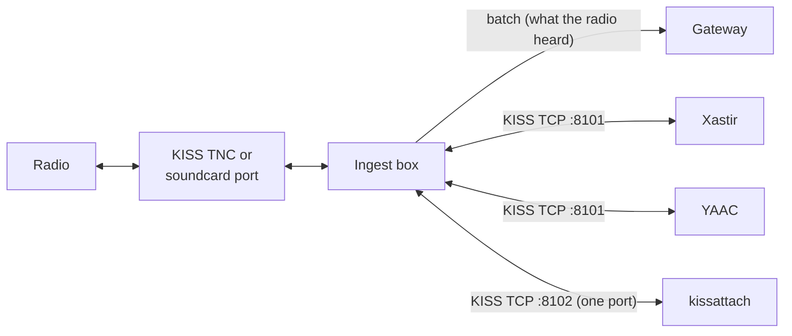

# Share the box's radio (KISS server)

This page turns on the ingest box's KISS server, so other packet programs use the box's radios as their TNC. It is
for the sysop. At the end APRSIS32, Xastir, YAAC, `kissutil`, Linux `kissattach` or QtTermTCP hear what the box's
radios hear, next to APRScaching, and can transmit through them when you allow it.

One radio, many programs: the box keeps its TNC or sound card to itself and serves KISS over TCP to the others.
Every program receives what the radio hears. Transmit is off until you turn it on, and then a fair queue per radio
port decides whose frame goes next.



## Before you start

- **An ingest box** with at least one radio port: a KISS TNC (`KISS_TNC_HOST`, [Direwolf as your TNC](direwolf.md))
  or a [soundcard port](soundcard.md). The server shares those ports only.
- **A free TCP port** on the box. Direwolf already uses 8001 for KISS, so this page uses 8101.
- **To let programs transmit**: a station call the gateway confirms for this box
  ([Transmit gate](rf-ingest.md#transmit-gate)), and [Automatic stations on the air](../compliance/on-air-stations.md).

## Steps

### 1. Turn the server on

In the ingest box's settings (`deploy/.env` in Docker):

```
KISS_SERVER_PORT=8101
```

Restart the ingest. Its log names the address and the radio ports it serves:

```
[kiss-server] listening on 127.0.0.1:8101 — 0=kiss-tnc, 1=kiss-tnc-1; transmit off
```

The server listens on `127.0.0.1`, so only programs on the box itself reach it. To serve your LAN, set
`KISS_SERVER_HOST` to the box's LAN address, such as `192.168.1.10`. In Docker the server runs inside the
container: set `KISS_SERVER_HOST=0.0.0.0` and publish the port on one host address in `compose.yml`, for
example `ports: ["127.0.0.1:8101:8101"]`.

### 2. Choose the radio ports and their numbers

A KISS frame names its port with a number from 0 to 15. By default the server exposes every radio port of the box,
numbered in this order: the KISS TNC's transmit channel (`kiss-tnc`, or `kiss-tnc-<n>` for channel n), the TNC's
other channels, then the soundcard ports (`soundcard-<name>`).

To pick the ports, list them in `KISS_SERVER_PORTS`, each as `[<kiss port>=]<radio port>`. An entry without a
number takes its place in the list:

```
KISS_SERVER_PORTS=0=kiss-tnc,2=soundcard-uhf
```

The box's LoRa APRS port is never exposed: LoRa APRS packets are text lines, not AX.25 frames, and the port never
transmits.

Many programs speak only KISS port 0. For them, `KISS_SERVER_PORT_LISTENERS` opens extra TCP ports, each carrying
one KISS port as port 0, the shape of Direwolf's `KISSPORT <tcp> <channel>`:

```
KISS_SERVER_PORT_LISTENERS=8102=2
```

A program on 8102 hears the UHF soundcard port alone, as port 0, and transmits on it as port 0.

### 3. Connect a program

Point the program at the box's address and port 8101 (or a single-port listener). The settings' names come from
each program's documentation, not from a test of every version: **Unverified**.

| Program | Setting |
|---|---|
| **APRSIS32** | **Configure → Ports → New Port**, type **KISS**, connection **TCP/IP**, host and port 8101. |
| **YAAC** | **File → Configure → Expert mode → Ports → Add**, type **KISSoverTCP**, host and port 8101. |
| **Xastir** | Xastir reads KISS from a serial port. Bridge one to the server with `socat pty,link=/tmp/kisstnc,raw,echo=0 tcp:127.0.0.1:8101`, then add a **Serial KISS TNC** interface on `/tmp/kisstnc`. |
| **QtTermTCP** | **Setup → KISS**, **TCP**, host and port 8101. |
| **`kissutil`** (ships with Direwolf) | `kissutil -h 127.0.0.1 -p 8101` prints what the radio hears; a typed line such as `OE8APR-7>APRS:>test` is sent. |
| **Linux `kissattach`** | Bridge a pseudo-terminal with `socat pty,link=/tmp/kiss,raw,echo=0 tcp:127.0.0.1:8102`, add a port `radio OE8APR-3 1200 255 2 Radio` to `/etc/ax25/axports`, run `kissattach /tmp/kiss radio`, then `axcall radio OE8BBS`. Use a single-port listener: the kernel sends on port 0. |

### 4. Let programs transmit (optional)

```
KISS_SERVER_TX=1
```

With transmit on, a frame a program sends goes out only when all of this holds:

- its source's base call is one `KISS_SERVER_TX_CALLS` lists. The default is the base calls of the box's own
  station calls (`BOX_CALL`, `DIGI_CALL`, `IGATE_CALL` and the others), so `OE8APR-7` passes when the box runs
  as `OE8APR-10`;
- the program sees the radio port it names;
- the program stays within its budget: 10 frames and 4 KiB a minute, 16 frames waiting per port. Past the budget a
  frame is refused; on a full queue the oldest waiting frame is dropped. A frame that waited a minute is dropped;
- the server's pacing has a token: `KISS_SERVER_TX_BURST` (6) at once, then one more every
  `KISS_SERVER_TX_REFILL_SEC` (10) seconds, for all programs together
  ([Transmit pacing](../compliance/on-air-stations.md#transmit-pacing));
- the radio port's [transmit gate](rf-ingest.md#transmit-gate) is open: the box's transmit switch is on and the
  gateway confirms the base call for this box.

Programs on one radio port take turns, one frame each, so a busy one cannot hold the channel. Pacing applies to
every frame, connected-mode frames too, so a long `axcall` session through the server is slow by design.

## How the server treats frames

| What | What happens |
|---|---|
| A frame a radio port heard | Sent to every connected program that sees the port, on its KISS port number. |
| A frame the box itself transmits (digipeater, IGate, beacons) | Not sent to the programs. The server passes on what the receiver hears, and the box drops its own signal heard back. |
| A frame one program transmits | Goes to the radio only. Other programs do not see it; Direwolf behaves the same unless its `KISSCOPY` option is set. |
| A KISS command from a program (TXDELAY, PERSIST, SLOTTIME, TXTAIL, FULLDUPLEX, SETHARDWARE) | Ignored. The box sets its TNC's timing ([TNC timing](rf-ingest.md#tnc-timing)); one program must not change the channel access the others share. |
| Return from KISS (`0xFF`) | Ignored; the connection stays in KISS. |
| A SMACK or FlexNet CRC (the Linux `mkiss` driver's probes) | Checked and removed. |

The log names each program as it connects and leaves, and says once per program why a frame was refused:

```
[kiss-server] 127.0.0.1:50122 connected, 1 of 8
[kiss-server] 127.0.0.1:50122: it sent a frame whose source is not a call KISS_SERVER_TX_CALLS lists
[kiss-server] 127.0.0.1:50122 disconnected (refused: 3 call)
```

## Trust: a program's frames are never hearings

A frame a program hands the server did not cross the air to the box's receiver. The box transmits it and never
posts it to the gateway as heard on RF, so the receiving site never attests it, and it cannot count toward
Tier A. When the TNC or the soundcard port hears the box's own transmission back, the box drops it like any
frame it sent ([Receiving site and Tier A](rf-ingest.md#receiving-site-and-tier-a)).

## Security

- **Keep the server off the internet.** KISS has no login: anyone who reaches the port hears your radio and, with
  transmit on, keys it under your callsign's rules. The default `127.0.0.1` keeps it on the box; a LAN address is
  your explicit choice. Never publish the port on a public address or forward it through a router.
- **Transmit is opt-in** (`KISS_SERVER_TX=1`) and limited to the calls `KISS_SERVER_TX_CALLS` lists, which the
  gateway must confirm for this box. You stay the control operator of everything these programs send.
- `KISS_SERVER_MAX_CLIENTS` (8) bounds the connections. A program that stops reading is disconnected.

## Check that it worked

Run `kissutil -h 127.0.0.1 -p 8101` on the box. Within a few minutes on a busy APRS channel, it prints the frames
the radio hears, each with its port, such as `[0] OE8XYZ-7>APRS,WIDE1-1:!4703.33N/01525.56E>`.

CI runs Direwolf's `kissutil` against the server every week: it hears a frame a real Direwolf modem received, and a
frame it sends with transmit off never reaches the air
([Interop against real packet software](../../contribute/testing.md#interop-against-real-packet-software)).

## Next

- [Direwolf as your TNC](direwolf.md): the TNC the server shares.
- [Configuration](../../reference/configuration.md): every `KISS_SERVER_*` setting and its default.
